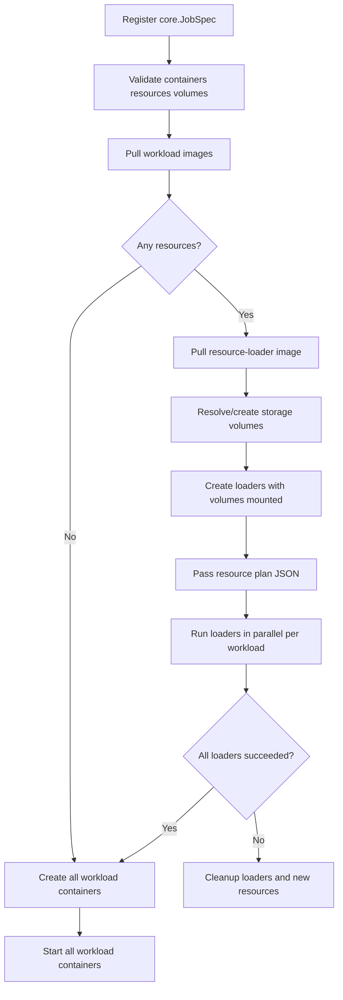

# Node Agent

The node agent is the data-plane process running on a machine that owns a
Docker daemon. It exposes separate admin and workload-proxy servers. The
admin side validates registration, prepares workloads, manages Docker, and
publishes lifecycle/resource events. The proxy only forwards approved traffic.

## Quick Start (Docker)

```bash
docker run -d \
  --name orcn-node-agent \
  --restart unless-stopped \
  -p 9090:9090 \
  -p 8081:8080 \
  -v /var/run/docker.sock:/var/run/docker.sock \
  -e NODE_AGENT_ADMIN_TOKEN="your-admin-token" \
  -e NODE_AGENT_REGISTRATION_API_KEY="your-registration-key" \
  -e AGENT_MODE="shared" \
  -e MAX_WORKLOAD_COUNT="10" \
  -e NODE_AGENT_ADMIN_ADDRESS="0.0.0.0:9090" \
  -e NODE_AGENT_PROXY_ADDRESS="0.0.0.0:8080" \
  orcn/node-agent:latest
```

**Important:** Use bridge mode (`-p` port mapping) instead of `--network host`.
On WSL2, `--network host` does not expose ports to the Windows host.

### Ports
| Port | Purpose | Default |
|------|---------|---------|
| 9090 | Admin API (register, health, capabilities, logs) | `0.0.0.0:9090` |
| 8081 | Proxy (public workload traffic) | `0.0.0.0:8080` (container) → `8081` (host) |

### Required Environment Variables
| Variable | Description |
|----------|-------------|
| `NODE_AGENT_ADMIN_TOKEN` | Bearer token for all admin endpoints (`/capabilities`, `/healthz`, `/registrations`, `/metrics`, `/register`, `/unregister`, `/containers/*`, `/logs`, `/events`) |

### Machine Registration (from gateway)
```
Endpoint:       http://<host-ip>:9090
Proxy Endpoint: http://<host-ip>:8081
Token:          <NODE_AGENT_ADMIN_TOKEN>
```

### Verify
```bash
# Admin health (requires AdminToken)
curl -H "Authorization: Bearer <admin-token>" http://127.0.0.1:9090/healthz

# Capabilities (requires AdminToken)
curl -H "Authorization: Bearer <admin-token>" http://127.0.0.1:9090/capabilities

# Proxy health (no auth)
curl http://127.0.0.1:8081/health
```

## Resource preparation

Resource preparation is a batch barrier: every required resource for every
declared container must finish before any workload container starts.



Events use a stable envelope with flexible metadata:

```json
{
  "id": "model-resource",
  "container_id": "ai-master",
  "type": "progress",
  "message": "resource download progress",
  "level": "info",
  "metadata": {
    "resource_id": "model-resource",
    "resource_type": "http",
    "downloaded_bytes": 52428800,
    "total_bytes": 104857600,
    "percentage": 50
  }
}
```

The frontend can consume `type: "progress"` events and render a progress
indicator without knowing installer-specific fields.

## Testing

Normal tests:

```bash
go test ./...
```

Docker-backed integration tests:

```bash
NODE_AGENT_TEST_PROXY_HOST=127.0.0.1 \
go test -tags integration ./services/node-agent \
  -run TestNodeAgentDockerIntegration -v
```

## Troubleshooting

**Ports not accessible from host (WSL2):**
- Do NOT use `--network host` - it doesn't forward ports to Windows host
- Use `-p 9090:9090 -p 8081:8080` bridge mode instead
- Verify inside container: `docker exec orcn-node-agent netstat -tlnp | grep -E "9090|8080"`
